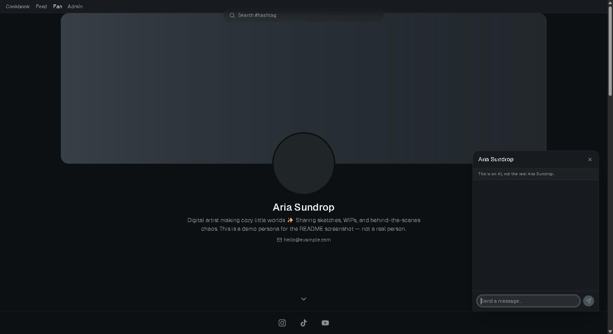
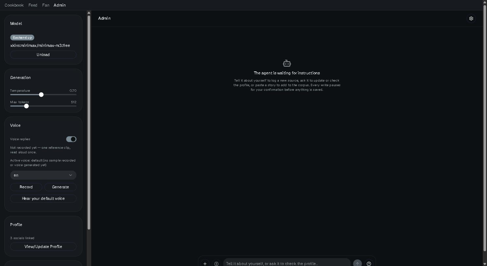

# self_presentation_AI

A portfolio page for a content creator — links, socials, media — with a chatbot that answers audience questions as an AI representation of the creator, grounded in a character profile they write themselves. Local-first by default: the LLM, the embedder, and text-to-speech each run on your own machine — but each of those three roles can independently switch to a hosted API instead (an OpenAI-compatible/Anthropic endpoint for the LLM, Gemini for embeddings, Fish Audio for TTS), picked per-role by the cookbook and written to `config/stack.json`.

| Fan page + chat | Admin console |
|---|---|
|  |  |

Shown with a fictional demo persona ("Aria Sundrop") and default placeholder avatars — not a real creator's data.

**Stack:** FastAPI · Next.js/React · llama.cpp · OpenAI-/Anthropic-compatible LLM adapters (+ Gemini/Fish Audio API fallbacks for embedding/TTS) · retrieval-augmented character memory · Qwen TTS voice cloning · Docker Compose (multi-service, GPU-aware) · hardware-probed model fitting

## The one rule everything else follows

**The creator is the sole author of the character.** Whatever they say about themselves is canon — factual, invented, or any mix; that's entirely their call. Everything downstream only transcribes.

- `data/sources.md` — raw Q&A, append-only, verbatim. The only truth.
- `data/character.md` — a readable profile derived from it. Every statement carries a cite (`[S-004]`) pointing at the entry behind it.

A statement in `character.md` with no cite is a bug, not a draft. The bot answers from the documented record or says it doesn't know — it never improvises a personality or fills a gap with something plausible-sounding, because invention there is authorship it doesn't have. An uncited gap at authoring time becomes an honest "I don't know" at chat time, on purpose.

## How it's built

**Character bible.** `sources.md`/`character.md`, described above, plus a story corpus (`data/stories/`) for longer personal anecdotes — indexed and retrieved by keyword, not held in context whole.

**Runtime.** An OpenAI-compatible backend talking to either a local `llama.cpp` server (models fitted and downloaded through the cookbook) or a hosted API, with the same two adapters (`openai`, `anthropic`) covering every LLM provider. Embedding and TTS get the same local-or-API choice independently — `roles.embedding.source`/`roles.tts.source` in `config/stack.json` — but through their own dedicated clients (`runtime/embed_api.py` for Gemini, `runtime/voice_api.py` for Fish Audio) rather than the generic LLM adapters, since neither is an OpenAI-compatible endpoint. Prompt assembly adapts to what fits: the whole bible in context on a machine that can hold it, otherwise a compact persona plus a `recall` retrieval tool — decided fresh per request against the model's real context budget, never hardcoded.

**Two surfaces, different rules.**
- **Admin** — the creator. Agentic: a client-side tool loop (`web/lib/chat/agentLoop.ts`) that can propose edits to the bible, gated behind an explicit confirm dialog before anything touches `data/`.
- **Fan** — the audience. Read-only. The only tool it can ever be offered is `recall(query)`; a client-supplied tool call is rejected unconditionally, so a forged request can't reach a write path.

**Cookbook.** Probes your hardware (VRAM, RAM ceiling, GPU driver) and works out which combination of LLM, embedding, and TTS models actually fits together in memory — not one model at a time, the whole resident stack. Writes the answer to `config/stack.json`. See `cookbook/README.md` for the fitting logic.

**Web.** A Next.js app with four routes: `/` (the cookbook's probe/fit/download wizard), `/admin` (the creator's chat + bible editor), `/fan` (the public portfolio page + chat widget), and `/feed` (a creator directory, for a future multi-creator deployment — single-creator is the only supported mode today).

**Voice.** Text-to-speech runs through `qwentts.cpp`, launched via `docker run` against whatever Docker daemon is reachable — **this needs Docker Desktop running even when the rest of the app runs natively, not in a container.** A one-time reference clip (`data/voice/sample.wav`) lets it clone the creator's own voice instead of a stock one.

## Quickstart

### Docker (recommended)

```bash
docker compose up --build
```

Brings up the cookbook (`:8001`), the admin-mode chat service (`:8000`), and the web frontend (`:3000`) together. Open `localhost:3000`, use the cookbook page to probe your machine and fit a model stack — it writes `./config/stack.json` and downloads weights into `./models/`, both already mounted into the running containers, so nothing needs restarting once it's done.

Needs `nvidia-container-toolkit` on the host for GPU passthrough, and Docker Desktop running for TTS regardless.

A real deployment splits into a public, tools-off surface: `docker compose --profile fan up service-fan web` (leaves `service-admin` off).

### Native

```bash
uv sync --extra runtime          # add --extra admin too for social-scraping tools
uv run uvicorn cookbook.api:app --port 8001     # fit + download a stack first
uv run uvicorn service.main:app --port 8000     # then the chat backend
cd web && npm install && npm run dev            # :3000
```

Python is pinned to `3.11`; torch comes from PyTorch's own `cu126` index (the plain PyPI wheel for Windows is CPU-only). An NVIDIA GPU is strongly recommended — CPU-only fits exist but are slow enough to notice.


## Authoring a character

```bash
mkdir -p data
cp templates/character.template.md data/character.md
cp templates/sources.template.md data/sources.md
cp templates/redaction-policy.template.md data/redaction-policy.md
```

Then work through the Open Questions list in `data/sources.md`, answering as the creator, in their own words, verbatim — don't tidy the phrasing, it's the best voice data in the project. Each answer becomes the next `S-###` entry; update the sections of `character.md` it feeds, with a cite. Single-sourced claims stay marked `(tentative)` until a second source backs them. Contradictions get flagged, never silently resolved.

Redaction happens at ingestion, not as cleanup after: exact addresses, full names of third parties, phone numbers, exact dates — reduced to the fact without the fingerprint (a flight date becomes `[~mid-July]`) before anything is written down, per whatever table `data/redaction-policy.md` currently holds. A bracketed value is always a fuzzed replacement, never an original.

## Repo layout

| Path | What it is |
|---|---|
| `templates/` | Blank character/sources/redaction-policy templates — the only tracked authoring files |
| `data/` | One creator's live instance: bible, stories, voice sample, images. Never committed |
| `runtime/` | Model backends, prompt assembly, the admin tool loop, story indexing, scrapers |
| `service/` | The FastAPI chat/admin backend (`service/main.py`) |
| `cookbook/` | Hardware probe, model catalogue, the stack fitter, its own FastAPI backend |
| `web/` | The Next.js frontend — cookbook wizard, admin chat, fan page, feed |
| `docker/` | Container entrypoint and the self-hosted SearXNG instance backing handle resolution |
| `config/` | `stack.json`, written by the cookbook. Gitignored, per-machine |
| `models/` | Downloaded weights. Gitignored |

## Privacy

**`data/` is never committed.** `.gitignore` denies by default — everything is ignored unless explicitly allowed, so a new file stays untracked until someone opts it in. Only `templates/`, the docs at the repo root, and application code are tracked; nothing under `data/`, `config/`, or `models/` is.

Adding a new source directory later means adding one whitelist line (`!src/**`). Deliberate: the cost is one line, the benefit is that forgetting to update `.gitignore` can never leak a creator's personal information.

## Disclosure

Any deployment must make clear to visitors that they're talking to an AI representation, not the person. The creator's own answers are the only source material, and the creator should review the profile before it goes live.
